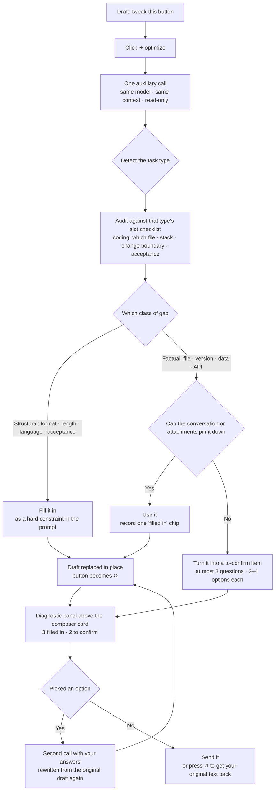

# dsh-prompt-polish · prompt optimization

[中文](README.md) · **English**

A composer plugin for [DeepSeek Harness](https://github.com/deepseek-ai/deepseek-harness) (DSH): adds a button next to the model selector that rewrites the draft in the composer into a directly executable prompt, **using the same model and the same context as the current session**. When it finishes, the button turns into an undo control.



## What problem does it solve

A one-line request usually gets an answer that drifts. Not because the model is weak, but because the line itself is missing things: which file, for whom, how long, what counts as done. Every follow-up question the model has to ask is a round trip you did not want.

Before you hit send, the plugin turns that line into an instruction the other side has to follow:

| What you typed | Before | Now |
| --- | --- | --- |
| `tweak this button` | The model guesses which button and how, gets it wrong, you explain again | It says "which file" is not its call to make, offers concrete candidates to click, and fills in format plus acceptance criteria |
| `write me a weekly report` | You get a template that does not sound like you | It fills in audience, length, tone and mandatory points, **and tells you which ones it filled** |
| `what about this error` | Either a vague overview or ten questions back at you | It pulls the error, file and version out of the recent conversation and attachments; only what it cannot pin down becomes a question — at most three, each one click away |

It does not "polish wording". It **audits, fills, and asks only when it must**:

1. **Detect the task type** — coding / writing / analysis / image generation / other. Each one misses different things.
2. **Check the gaps against that type's checklist** — for coding: which file, stack, current state and error, change boundary, acceptance criteria, compatibility constraints.
3. **Two classes of gaps, two treatments** — this is the core:
   - **Structural** (output format, length, language, acceptance criteria — the "how") → decided for you, written into the prompt as hard constraints, and listed in the panel so you can see it.
   - **Factual** (specific file, path, version number, data, API, person) → **never invented**. Used when the conversation or the attachments pin it down; anything else becomes a "to confirm" item.
4. **One click and it rewrites with your answer** — from the draft you first typed, never from the text it had just produced.

The payoff in one line: **one less follow-up, one less drift.**

## Install

This is a **local bundle** for DSH (declared through `dsh.bundle.patch` in `package.json`). No compilation, no build tooling.

```bash
git clone https://github.com/nolodjska/dsh-prompt-polish.git
```

Then install it into your current profile from inside DSH:

```
plugin_manager install_bundle  →  target: <absolute path to the clone>
```

After installing, **reload the page** (`Ctrl+R` / `Cmd+R`) to load the browser-side bundle.

To uninstall:

```
plugin_manager remove_bundle   →  target: @local/prompt-polish
```

> `private: true` is deliberate: this is a bundle installed from a directory, not published to npm.

**Requirements**: a DSH build with the web GUI. The plugin runs inside the DSH process and page, needs no Node runtime of its own, and `package.json` has no dependencies — you only need Node locally to run the self-check (`node test/run-all.mjs`).

## How to use

1. Type a draft in the composer (**at least 4 characters** — `hi` will not enable the button).
2. Click **✦** next to the model selector.
3. Wait for it to finish: the composer already holds the rewritten prompt and the button has become **↺**. If it filled something in or has something to ask, a diagnostic panel appears above the composer card.
4. To back out, click **↺** — it restores your original text exactly. If you edited the result yourself after it landed, ↺ disables itself rather than overwrite your edits.

| State | Button | Composer |
| --- | --- | --- |
| Idle | ✦ optimize (disabled below 4 characters) | Normal |
| Running | Spinner, disabled | A softly shimmering skeleton tracking the composer height; **you can keep typing** |
| Done | ↺ undo | Holds the rewritten prompt; a diagnostic panel appears above when there is something to report |
| Clarifying | Spinner, disabled | Skeleton keeps playing; the panel collapses to one line, "Rewriting with your answers…" |
| Failed | One short message beside the button, gone after 6 seconds | Your original draft, untouched |

A few things worth knowing up front:

- **Switching sessions does not abort anything.** Once the request is out you can jump to another session; it finishes in the background and writes back only to the session that started it. Other sessions' drafts stay untouched in the meantime, and the button never sticks in "optimizing".
- **No duplicate requests.** One in-flight request per session: double clicks, switching away and back, nothing fires or writes twice.
- **A closed session is dropped silently.** If the session that started a rewrite is closed or deleted before it finishes, the result is discarded without an error and without affecting other sessions.
- **Real newlines stay real.** If the model flattens multiple lines into one and represents breaks with literal `\n`, the plugin decodes them into real newlines before writing to the composer (a quoted `'\n'` — the prompt *mentioning* the escape — is left alone).
- **Only the prompt itself gets through.** Trailing noise like "Here is the rewrite:", "shorter version" or "what I changed" cannot reach the composer: the body is required to sit between `[[PROMPT_BEGIN]] … [[PROMPT_END]]` and the Host reads only what is inside those markers. If the model ignores the format there are three fallbacks (JSON object, `<prompt>` tag, meta-section truncation).

## The diagnostic panel: what it filled in, what is still open

The panel appears only when something was **actually filled in** or there is **actually a decision for you to make**. A clean rewrite shows nothing.

| Row | Content | What you do |
| --- | --- | --- |
| Title | `3 filled in · 2 to confirm` for a coding task | `×` on the right collapses the panel; ↺ undo stays available |
| Filled in | One chip per slot that was filled, e.g. `output format=Markdown table` | Already written into the prompt, just read it |
| To confirm | At most 3 questions, 2–4 candidates each, the first marked "suggested" | Click any candidate → **rewritten from the original draft** with your answer |
| Changed | One line saying what it changed | Nothing |

- **Anything you answered is never asked again.**
- **Prefer to write the answer yourself?** Do not click a candidate: edit the draft and press ✦ again.
- **Clicking a candidate costs exactly one more request**, and ↺ always returns to **the text you first typed**.
- Collapsing the panel, editing the rewritten text, or sending it all invalidate it — the same rule that governs ↺.

## Configuration

**There is no settings page; every knob is a constant.** That keeps one component out of the plugin: fewer than a dozen things are worth tuning, and editing a line beats a settings screen.

After changing one, **reload the page** (for `client.js`) or **restart DSH** (for `optimize.js`).

### Which model does it use?

Nothing to configure. It resolves in three tiers and uses the first hit:

| Tier | Source | When it applies |
| --- | --- | --- |
| 1 | `provider`/`model` from the last request record in the session log | The session has already sent a message (the usual "same model" case) |
| 2 | The model currently selected next to the composer | A new session that has not sent anything yet |
| 3 | The deployment default model | A brand-new session where nothing has been selected either |

The reasoning effort is carried over as well. Only when all three tiers fail does it report an error — **having no conversation history is not a reason to refuse**; the very first message of a session is optimized like any other.

### Common tweaks: what you want → what to change

All of these live in the constants block at the top of `optimize.js` (Host side) or `client.js` (browser side).

| You want | Change | Default |
| --- | --- | --- |
| A more restrained / more eager rewriter | The two bullets under "two classes of gaps" in `SYSTEM_PROMPT` | — |
| More questions in the panel | `PLAN_LIMITS.questions` | 3 |
| More "filled in" chips | `PLAN_LIMITS.assumptions` | 6 |
| Character caps for chips and questions | `PLAN_LIMITS.slot` / `value` / `question` / `option` | 10 / 30 / 20 / 12 |
| Length of the "changed" line | `PLAN_LIMITS.notes` | 120 |
| Carry more confirmed answers | `MAX_ANSWERS` | 6 |
| Draft length ceiling | `MAX_DRAFT_CHARS` | 20000 |
| Wait longer for one rewrite | `CALL_TIMEOUT_MS` (Host), `TIMEOUT_MS` / `TIMEOUT_MS_WITH_IMAGES` (browser) | 60s / 90s / 120s |
| More or fewer turns of context | `CONTEXT_MAX_MESSAGES` / `CONTEXT_TOTAL_MAX_CHARS` | 6 messages / 6000 characters |
| Read more of an attached file | `FILE_EXCERPT_BYTES` / `FILE_EXCERPT_TOTAL_BYTES` | 8 KB / 24 KB |
| Lower the minimum draft length | `MIN_DRAFT_CHARS` | 4 |
| More attachments per rewrite | `MAX_ATTACHMENTS` | 8 |

The numbers in `PLAN_LIMITS` are **hard ceilings**: however chatty the model gets, it cannot blow up the UI, and oversize values are clipped. To loosen them, change the limits written into the system prompt at the same time — the prompt and `PLAN_LIMITS` deliberately share one set of numbers.

### What context is included (and why that is safe)

The rewrite carries "everything the current session can see right now", all of it **read-only**, and all three sources may be empty:

1. **Recent conversation** — the last 6 user/assistant messages, text blocks only, used to resolve references like "this / it / the one above". When there is none, the section is omitted entirely.
2. **Attachments on the composer**:
   - Images: **actually sent to the model as images** when the model route accepts image input, along with name and dimensions;
   - Text-like files (`.md` `.txt` `.json` `.ts` `.py` `.log` …): the first 8 KB of content, 24 KB total;
   - Everything else (PDF, archives…): name and size only.
   - Every request also carries an attachment inventory stating, item by item, whether the model **can** see the content — so the rewrite cannot invent things that are inside an attachment it never read.
3. **Model route** — see the three tiers above.

One key property: the rewrite happens in an **auxiliary call** — it writes no session events, creates no messages, does not touch your attachments and has zero effect on your real conversation with the model. Attachments are background for understanding the draft; the plugin explicitly forbids moving their content into the prompt body.

## Compatibility

The plugin relies on three **internal implementation details** of DSH (not public contracts):

1. `ConversationService.serializeDraftAttachments()` — reading the bytes of composer attachments;
2. `[data-composer-card]` / `[data-composer-overlay]` / `[data-composer-input]` — measuring the skeleton;
3. `PreparedLlmCall.inputModalities` — deciding whether a model accepts images.

If a DSH upgrade changes them, the plugin **degrades instead of breaking**: attachments stay out of the context / the skeleton falls back to a line-count estimate / images are described by name and size only. A line prefixed with `[prompt-polish]` appears in the console, usually one line of code to fix.

Similarly, if the model does not answer in the `[[PROMPT_BEGIN]]` / `[[PLAN_BEGIN]]` shape, the plugin still produces a usable prompt (via the JSON / XML / plain-text fallbacks) — only the diagnostic panel is missing. Degraded, never broken.

## Layout

```
index.js           Host: registers POST /api/prompt-polish/optimize
optimize.js        Host: route resolution + context/attachment gathering + one model call + body sanitizing + diagnostic parsing
client.js          Browser: button, skeleton, diagnostic panel, undo
package.json       Bundle manifest (dsh.bundle.patch + dsh.client)
cordis.patch.yml   Loader patch that inserts the plugin row
locale/*.json      Plugin-manager title and description (zh/en)
icon.svg           Plugin icon
docs/protocol.md   Internal protocol and implementation notes (read before changing code)
docs/design-v2.md  Design contract: protocol, prompt structure, limits
test/*.mjs         Offline self-checks
```

## Self-check

No running DSH instance and no network needed — plain Node:

```bash
node test/run-all.mjs
```

It covers module loading and slot registration, the five UI states and undo semantics, the diagnostic panel's visibility and wire format, attachment gathering and degradation, skeleton geometry, and the Host side: route resolution, output extraction, diagnostic parsing, timeouts and cancellation. Run it after a change; when it is green, reload the page.

## License

[MIT](LICENSE) © 2026 KALUSO

This plugin is free software: commercial use, modification, redistribution and closed-source integration are all fine. No fee, and you do not have to publish your changes. **The only obligation** is to keep the copyright and permission notice — carry the text in [LICENSE](LICENSE) along with the code (a `LICENSE` file in your project, or an attribution in your about page or docs, both count).

The software is provided "as is", without warranty of any kind; you bear the consequences of using it.

This plugin and the DeepSeek Harness host it runs in are separate works — **this license does not change the host's own license terms**. The plugin bundles no third-party code and has no runtime dependencies, so no other open-source licenses are involved.
