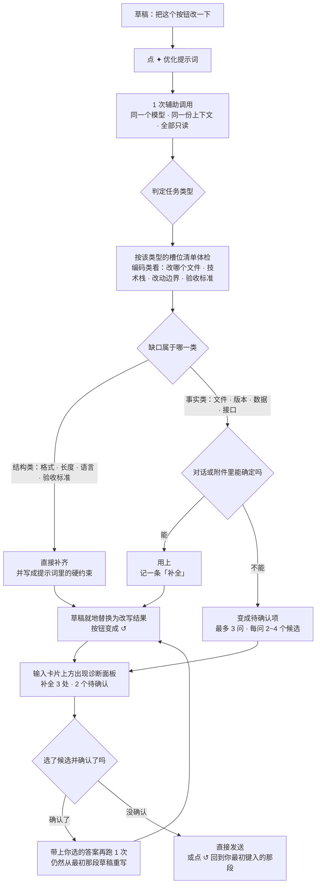

# dsh-prompt-polish · 提示词优化

**中文** · [English](README.en.md)

[DeepSeek Harness](https://github.com/deepseek-ai/deepseek-harness)（DSH）的输入框插件：在模型选择器旁边加一个按钮，**用当前会话同一个模型、同一份上下文**，把输入框里的草稿改写成一条可直接执行的提示词。生成结束后按钮变成撤回键。



## 它解决什么问题

随手敲的一句话，模型经常答偏。不是因为模型笨，而是这句话本身缺了几样东西：改哪个文件、给谁看、多长、怎么算完成。你不在现场的每一次追问，都是一次来回。

这个插件在你按下发送之前，把那一句变成一条对方不得不照做的指令：

| 你写的 | 以前 | 现在 |
| --- | --- | --- |
| `把这个按钮改一下` | 模型猜是哪个按钮、怎么改，猜错了你再说一遍 | 指出「改哪个文件」是它不能替你定的，列出候选让你点；格式与验收标准直接补齐 |
| `帮我写个周报` | 拿回一篇不像你风格的模板文 | 补上读者、长度、语气、必须包含的要点，**并告诉你补了哪几项** |
| `这个报错怎么办` | 模型要么泛泛而谈，要么反过来问你十句 | 从最近对话与附件里把报错、文件、版本捞出来写死；捞不到的才问，且一次最多三问、每问都能一键选 |

它做的不是"润色措辞"，而是**先体检、再补齐、该问就问**：

1. **判定任务类型** —— 编码 / 写作 / 分析 / 生成图片 / 其他，不同类型缺的东西不一样。
2. **按类型的清单查缺口** —— 编码类看的是「改哪个文件、技术栈、现状与报错、改动边界、验收标准、兼容约束」。
3. **两类缺口，两种处理** —— 这是关键：
   - **结构类**（输出格式、长度、语言、验收标准这类"做法"）→ 直接替你定，写成提示词里的硬约束，并在面板上列出来让你看见。
   - **事实类**（具体文件、路径、版本号、数据、接口、人名）→ **绝不编造**。能从对话或附件里确定的就用上；确定不了的变成「待确认」。
4. **你点一下，它按你的答案重写** —— 用的是你最初那段草稿，不是在被改写的文本上再改一遍。

一句话概括收益：**少一轮追问，少一次答偏。**

## 安装

本插件是 DSH 的**本地 bundle**（`package.json` 里声明了 `dsh.bundle.patch`），不需要编译、不需要构建工具。

```bash
git clone https://github.com/nolodjska/dsh-prompt-polish.git
```

然后在 DSH 里把它装进当前 profile：

```
plugin_manager install_bundle  →  target: <克隆目录的绝对路径>
```

装好后**刷新页面**（`Ctrl+R` / `Cmd+R`）加载浏览器端 bundle。

卸载：

```
plugin_manager remove_bundle   →  target: @local/prompt-polish
```

> `private: true` 是故意的：这是从目录安装的本地 bundle，不发布到 npm。

**环境要求**：一个带 Web GUI 的 DSH。插件跑在 DSH 进程与页面里，不额外装 Node 运行时，`package.json` 里也没有任何依赖——只有跑自检（`node test/run-all.mjs`）时才需要本机有 Node。

## 怎么用

1. 在输入框里写草稿（**至少 4 个字符**，`hi` 这种不给点）。
2. 点模型选择器右边的 **✦**。
3. 等它跑完：输入框里已经是改写结果，按钮变成 **↺**；如果它补过东西或有事要问你，输入卡片上方出现诊断面板。
4. 想反悔就点 **↺** —— 精确还原你原来那段文字。如果生成后你自己动过手，↺ 会自动失效，不会覆盖你的编辑。

| 状态 | 按钮 | 输入框 |
| --- | --- | --- |
| 空闲 | ✦ 优化提示词（草稿不足 4 字时禁用） | 正常 |
| 生成中 | 转圈，禁用 | 微微发光的骨架屏，高度跟随输入框，**仍可继续打字** |
| 完成 | ↺ 撤回优化 | 已替换为改写结果；补过或有待确认时，上方出现诊断面板 |
| 澄清中 | 转圈，禁用 | 骨架屏继续播，面板收成一行「正在按你的选择重写…」 |
| 失败 | 旁边一行中文提示，6 秒后消失 | 原草稿原样保留 |

几个容易踩的点，提前说清：

- **切会话不打断**：请求发出后可以直接切到别的会话，它在后台跑完；结果只会写回**发起它的那个会话**，切回来就能看到。在那之前别的会话的草稿一动不动，按钮也不会卡在「优化中」。
- **不会重复发起**：同一个会话同一时刻只有一个在途请求，连点、切走再切回都不会重复写入。
- **会话被关掉就静默丢弃**：发起润色的会话若在完成前被关闭或删除，结果直接丢掉，不弹错、不影响其他会话。
- **换行是真换行**：模型若把多行压成一行、用 `\n` 字面量表示换行，插件会解码成真换行再写进输入框（`'\n'` 这种"在提到转义"的情况保持原样）。
- **只留提示词本身**：「改写如下：」「更短的版本」「改动说明」这类尾巴进不了输入框——正文被要求放在 `[[PROMPT_BEGIN]] … [[PROMPT_END]]` 之间，Host 只取标记之间的内容，标记之外写什么都丢弃；模型不按格式答时还有 JSON / `<prompt>` / 元信息截断三级兜底。

## 诊断面板：它替你补了什么、还差什么

面板只在**确实补过缺口**或**确有需要你决定的事**时出现；一次干净的改写不弹任何东西。

| 行 | 内容 | 你会做什么 |
| --- | --- | --- |
| 标题 | 类型徽标 + `补全 3 处 · 待确认 2` | 右侧 `×` 收起面板；↺ 撤回仍然可用 |
| 补全 | 每个被填的槽位一条标签，如 `输出格式` `Markdown 表格` | 已经写进提示词了，看一眼即可 |
| 待确认 | 最多 3 个问题，每个 2~4 个候选，第一个前面带 ★ | 点候选 = **选中**；选好点「确认并重写」，才按你的答案**从最初草稿重写** |
| 改动 | 一句话说明改了什么，右侧 `已选 1/2` | 无 |

- **回答过的不会再问。**
- **点候选不会立刻执行**：先选中（再点一次取消），都选好后点「确认并重写」才发请求——浏览选项不会误触。
- **多个问题一次带走**：三个问题只多发一次请求，撤回键始终回到**你最初键入的那段文字**。
- **想自己写答案**就不用点候选：直接改草稿，再点一次 ✦。
- 面板收起、你手动改动改写结果、或直接发送，都会让它失效——和 ↺ 的判定同一条线。

## 配置

**没有设置面板，所有配置都是改常量。** 这样做是为了少一个组件：真正需要调的东西不到十个，改一行比做一页设置更省事。

改完要**刷新页面**（`client.js` 的改动）或**重启 DSH**（`optimize.js` 的改动）。

### 它自动用哪个模型？

不用配。插件按下面三层依次取，取到即用：

| 层 | 来源 | 何时命中 |
| --- | --- | --- |
| 1 | 会话日志里最后一条请求记录的 `provider`/`model` | 会话已经发过消息（最常见的"同一个模型"） |
| 2 | 输入框旁当前选中的模型 | 新会话、还没发过消息 |
| 3 | 部署默认模型 | 全新会话、连模型都没选过 |

思考档位（`reasoningEffort`）一并沿用。只有三层都解析不出模型时才会提示失败——**没有对话历史不是拒绝的理由**，会话的第一条消息照样能优化。

### 常见调整：想改什么 → 改哪里

以下都在 `optimize.js`（Host 侧）或 `client.js`（浏览器侧）文件顶部的常量区。

| 你想要 | 改这个 | 默认 |
| --- | --- | --- |
| 让改写更克制／更敢补 | `SYSTEM_PROMPT` 里「第三步：两类缺口」那两条 | — |
| 改面板最多问几个问题 | `PLAN_LIMITS.questions` | 3 |
| 改面板最多列几条补全 | `PLAN_LIMITS.assumptions` | 6 |
| 改补全标签／问题的字数上限 | `PLAN_LIMITS.slot` / `value` / `question` / `option` | 10 / 30 / 20 / 12 |
| 改「改动」那一行的长度 | `PLAN_LIMITS.notes` | 120 |
| 允许一次带更多已确认答案 | `MAX_ANSWERS` | 6 |
| 放宽／收紧草稿长度上限 | `MAX_DRAFT_CHARS` | 20000 |
| 单次改写等更久 | `CALL_TIMEOUT_MS`（Host）、`TIMEOUT_MS` / `TIMEOUT_MS_WITH_IMAGES`（浏览器） | 60s / 90s / 120s |
| 多看／少看几轮对话 | `CONTEXT_MAX_MESSAGES` / `CONTEXT_TOTAL_MAX_CHARS` | 6 条 / 6000 字 |
| 附件正文多读一点 | `FILE_EXCERPT_BYTES` / `FILE_EXCERPT_TOTAL_BYTES` | 8 KB / 24 KB |
| 草稿几个字就允许优化 | `MIN_DRAFT_CHARS` | 4 |
| 一次最多带几个附件 | `MAX_ATTACHMENTS` | 8 |

`PLAN_LIMITS` 的数字是**硬上限**：模型再啰嗦也炸不了 UI，超出的会被裁掉。想让它更宽松，Host 和系统提示词里写给模型的字数要一起改（提示词里的上限与 `PLAN_LIMITS` 是同一组数字）。

### 上下文包含什么（以及为什么可以放心）

改写请求带的是「当前会话此刻能看到的全部相关上下文」，全部**只读**，而且三类都可以为空：

1. **最近对话** —— 最近 6 条用户/助手消息，只取文本块，用来消解「这个 / 它 / 上面那个」这类指代。一条都没有时这一段完全不出现。
2. **输入框上挂的附件**：
   - 图片：**真的作为图片发给模型看**（模型路由支持图片输入时），同时给出名称与尺寸；
   - 文本类文件（`.md` `.txt` `.json` `.ts` `.py` `.log` …）：读前 8 KB 正文，合计最多 24 KB；
   - 其他文件（PDF、压缩包…）：只给名称与大小。
   - 每次都会附带一段「附件清单」，逐项写明模型**能否**看到内容，所以改写结果不会凭空编造附件里的东西。
3. **模型路由** —— 见上文三层解析。

关键一点：改写在**独立的辅助调用**里完成——不写会话日志、不产生对话消息、不改你的附件，对你和模型的正式对话零影响。附件是「读懂草稿」的背景，插件明确禁止把附件内容搬进提示词正文。

## 兼容性

插件用了三处 DSH 的**内部实现细节**（不是公开契约）：

1. `ConversationService.serializeDraftAttachments()` —— 读输入框附件字节；
2. `[data-composer-card]` / `[data-composer-overlay]` / `[data-composer-input]` —— 量骨架屏高度；
3. `PreparedLlmCall.inputModalities` —— 判断模型是否收图片。

DSH 升级后如果这几处变了，插件会**降级而不是崩溃**：附件不进上下文 / 骨架屏退回按行数估算 / 图片只给名称尺寸。控制台会有一行带 `[prompt-polish]` 前缀的日志，照着改一行即可。

同理，模型若不按 `[[PROMPT_BEGIN]]` / `[[PLAN_BEGIN]]` 的格式作答，插件仍能交出可用的提示词（走 JSON / XML / 纯文本兜底），只是诊断面板不会出现——功能降级，不会报错。

## 目录结构

```
index.js           Host：注册 POST /api/prompt-polish/optimize
optimize.js        Host：路由解析 + 上下文/附件采集 + 一次模型调用 + 正文净化 + 诊断解析
client.js          浏览器：按钮、骨架屏、诊断面板、撤回
package.json       bundle 清单（dsh.bundle.patch + dsh.client）
cordis.patch.yml   Loader 补丁，插入插件行
locale/*.json      插件管理页的标题与描述（中/英）
icon.svg           插件图标
docs/protocol.md   内部协议与实现说明（改代码前先读这个）
docs/design-v2.md  设计契约：协议、提示词结构、上限
test/*.mjs         离线自检
```

## 自检

不需要 DSH 运行实例，不联网，纯 Node：

```bash
node test/run-all.mjs
```

覆盖模块加载与槽位注册、五个 UI 状态与撤回语义、诊断面板的显隐与线格式、附件采集与降级、骨架屏几何、Host 侧的路由解析/输出提取/诊断解析/超时取消。改完代码跑一遍，全绿再刷新页面。

## License

[MIT](LICENSE) © 2026 KALUSO

这个插件是自由软件，可以随便用：商用、修改、分发、闭源集成都可以，不需要付费，也不要求你公开自己的改动。**唯一的义务**是保留版权声明与许可声明——把 [LICENSE](LICENSE) 里的那段话随代码一起带走即可（在自己的项目里放一份 `LICENSE`，或在关于页/文档里注明出处都算）。

软件按"现状"提供，不附带任何担保；因使用它产生的后果由使用者承担。

本插件与其运行的宿主 DeepSeek Harness 是两个独立的作品，**本许可不改变宿主自身的许可条款**。插件本身不包含任何第三方代码，也没有任何运行时依赖，因此不涉及其它开源许可。
